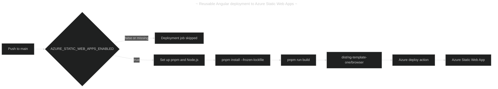

# Enable Azure Static Web Apps in `ng_template_one`

## Table of Contents

- [(1) Objective](#1-objective)
- [(2) Current template assessment](#2-current-template-assessment)
- [(3) Lessons from the deployment commits](#3-lessons-from-the-deployment-commits)
- [(4) Target design](#4-target-design)
- [(5) Implementation instructions](#5-implementation-instructions)
  - [(5.1) Preserve the generic Angular output path](#51-preserve-the-generic-angular-output-path)
  - [(5.2) Add the Azure SPA configuration](#52-add-the-azure-spa-configuration)
  - [(5.3) Copy the Azure configuration during builds](#53-copy-the-azure-configuration-during-builds)
  - [(5.4) Add the reusable deployment workflow](#54-add-the-reusable-deployment-workflow)
  - [(5.5) Update project documentation](#55-update-project-documentation)
- [(6) Configure an Azure deployment](#6-configure-an-azure-deployment)
- [(7) Verification procedure](#7-verification-procedure)
- [(8) Acceptance criteria](#8-acceptance-criteria)
- [(9) Variations](#9-variations)
- [(10) Mistakes to avoid](#10-mistakes-to-avoid)
- [(11) Agent handoff prompt](#11-agent-handoff-prompt)
- [(12) References](#12-references)

---

## (1) Objective

Prepare <https://github.com/carloswm85/ng_template_one> for reliable deployment to Azure Static Web Apps while keeping the Angular template reusable outside Azure.

The implementation must:

- Build with the repository's declared pnpm version instead of allowing Oryx to select npm.
- Deploy the already-built Angular browser artifacts.
- Support Angular client-side routes after a direct request or browser refresh.
- Avoid resource-specific names and deployment-token identifiers in the reusable template.
- Remain inactive until an Azure deployment is explicitly enabled in a repository created from the template.
- Preserve unrelated files and existing user changes.
- Not stage or commit changes unless explicitly requested.

---

## (2) Current template assessment

The target repository currently has the following relevant configuration:

|   # | Item                   | Current value                               | Situation                         |
| --: | ---------------------- | ------------------------------------------- | --------------------------------- |
|   1 | Angular project key    | `ng-template-one`                           | ✅ Keep                           |
|   2 | Angular builder        | `@angular-devkit/build-angular:application` | ✅ Produces a `browser` directory |
|   3 | Base output path       | `dist/ng-template-one`                      | ✅ Keep generic                   |
|   4 | Deployable output path | `dist/ng-template-one/browser`              | ✅ Use in Azure workflow          |
|   5 | Package manager        | `pnpm`                                      | ✅ Keep                           |
|   6 | Pinned package manager | `pnpm@11.17.0` in `package.json`            | ✅ Workflow must honor it         |
|   7 | Node.js target         | Node.js 22                                  | ✅ Compatible CI baseline         |
|   8 | Existing workflow      | Empty `.github/workflows/empty.yml`         | 🤔 Replace or remove              |
|   9 | Static Web Apps config | Missing                                     | ❌ Add                            |
|  10 | Build assets           | `src/favicon.ico` and `src/assets`          | 🤔 Add Azure configuration        |

The template should retain `dist/ng-template-one` as its Angular `outputPath`. Do not rename the build directory after an Azure resource, because an Angular template can be deployed to resources with different names and environments.

---

## (3) Lessons from the deployment commits

The `QuVe-Services/angular_test` experiment produced the following sequence on October 19, 2026:

|   # | Commit    | Change                                                        | Finding                                                 |
| --: | --------- | ------------------------------------------------------------- | ------------------------------------------------------- |
|   1 | `6217049` | Azure generated a resource-specific workflow                  | Oryx selected npm even though the repository uses pnpm  |
|   2 | `1ac52f2` | Changed Angular's base `outputPath`                           | Browser artifacts were generated under `<base>/browser` |
|   3 | `d49014f` | Merged the generated workflow and local path change           | Merge-only; no reusable design decision                 |
|   4 | `1b7c6b1` | Added the missing final newline to `angular.json`             | Formatting-only                                         |
|   5 | `36a17d9` | Added explicit pnpm CI, prebuilt deployment, and SPA fallback | ✅ Successful deployment pattern                        |

The failed Azure run stopped before Angular compilation:

```text
Running 'npm install'...
npm error Cannot read properties of null (reading 'edgesOut')
Oryx has failed to build the solution.
```

The repository contained `pnpm-lock.yaml` and declared pnpm in `package.json`, but Oryx still invoked npm. The durable solution is to make GitHub Actions own the install and build steps:

```text
pnpm install --frozen-lockfile
pnpm run build
```

Azure then deploys the prebuilt browser directory with:

```yaml
app_location: "dist/<angular-project>/browser"
output_location: ""
skip_app_build: true
```

---

## (4) Target design



The repository variable prevents template-derived repositories from attempting deployment before an Azure resource and deployment secret exist.

---

## (5) Implementation instructions

### (5.1) Preserve the generic Angular output path

Keep the following value in `angular.json`:

```json
"outputPath": "dist/ng-template-one"
```

Do not copy the experiment's value:

```json
"outputPath": "dist/stapp-angular-demo-dev"
```

The Azure resource name and Angular build directory serve different purposes. The build directory should remain stable and application-oriented.

### (5.2) Add the Azure SPA configuration

Create `src/staticwebapp.config.json`:

```json
{
  "navigationFallback": {
    "rewrite": "/index.html",
    "exclude": [
      "/assets/*",
      "/*.{css,js,json,ico,png,jpg,jpeg,gif,svg,webp,woff,woff2,ttf,map}"
    ]
  }
}
```

This fallback allows a route such as `/admin/dashboard` to return `index.html`, after which Angular Router handles the URL. The exclusions prevent missing static assets from being rewritten to HTML.

### (5.3) Copy the Azure configuration during builds

In `projects.ng-template-one.architect.build.options.assets` within `angular.json`, add `src/staticwebapp.config.json`:

```json
"assets": [
  "src/favicon.ico",
  "src/assets",
  "src/staticwebapp.config.json"
]
```

Do not add the file to the test target unless a test specifically requires it. The deployment requirement applies to the production browser build.

After this change, a production build must contain:

```text
dist/ng-template-one/browser/index.html
dist/ng-template-one/browser/staticwebapp.config.json
```

### (5.4) Add the reusable deployment workflow

Delete the empty `.github/workflows/empty.yml`.

Create `.github/workflows/azure-static-web-apps.yml` with the following content:

```yaml
name: Azure Static Web Apps CI/CD

on:
  push:
    branches:
      - main
  pull_request:
    types: [opened, synchronize, reopened, closed]
    branches:
      - main
  workflow_dispatch:

permissions:
  contents: read
  issues: write
  pull-requests: write

jobs:
  build_and_deploy:
    if: >
      vars.AZURE_STATIC_WEB_APPS_ENABLED == 'true' &&
      (
        github.event_name == 'push' ||
        github.event_name == 'workflow_dispatch' ||
        (
          github.event_name == 'pull_request' &&
          github.event.action != 'closed' &&
          github.event.pull_request.head.repo.full_name == github.repository
        )
      )
    runs-on: ubuntu-latest
    name: Build and deploy

    steps:
      - name: Check out repository
        uses: actions/checkout@v6

      - name: Set up pnpm
        uses: pnpm/action-setup@v6
        with:
          run_install: false

      - name: Set up Node.js
        uses: actions/setup-node@v7
        with:
          node-version: 22
          cache: pnpm

      - name: Install dependencies
        run: pnpm install --frozen-lockfile

      - name: Build Angular application
        run: pnpm run build

      - name: Deploy prebuilt application
        uses: Azure/static-web-apps-deploy@v1
        with:
          azure_static_web_apps_api_token: ${{ secrets.AZURE_STATIC_WEB_APPS_API_TOKEN }}
          repo_token: ${{ secrets.GITHUB_TOKEN }}
          action: "upload"
          app_location: "dist/ng-template-one/browser"
          api_location: ""
          output_location: ""
          skip_app_build: true

  close_pull_request:
    if: >
      vars.AZURE_STATIC_WEB_APPS_ENABLED == 'true' &&
      github.event_name == 'pull_request' &&
      github.event.action == 'closed' &&
      github.event.pull_request.head.repo.full_name == github.repository
    runs-on: ubuntu-latest
    name: Close preview environment

    steps:
      - name: Close preview environment
        uses: Azure/static-web-apps-deploy@v1
        with:
          azure_static_web_apps_api_token: ${{ secrets.AZURE_STATIC_WEB_APPS_API_TOKEN }}
          action: "close"
```

Important workflow behavior:

|   # | Configuration                          | Reason                                                     | Situation   |
| --: | -------------------------------------- | ---------------------------------------------------------- | ----------- |
|   1 | `pnpm/action-setup`                    | Reads the pinned pnpm version from `package.json`          | ✅ Required |
|   2 | `pnpm install --frozen-lockfile`       | Reproduces the committed dependency graph                  | ✅ Required |
|   3 | Explicit `pnpm run build`              | Prevents Oryx from selecting npm                           | ✅ Required |
|   4 | Browser directory as `app_location`    | Points Azure to the files that must be served              | ✅ Required |
|   5 | Empty `output_location`                | Required when deploying prebuilt files                     | ✅ Required |
|   6 | `skip_app_build: true`                 | Prevents a second Oryx build                               | ✅ Required |
|   7 | Generic deployment-token secret        | Avoids resource-specific secret suffixes in the template   | ✅ Required |
|   8 | Repository-variable deployment gate    | Keeps deployment disabled in template-derived repositories | ✅ Required |
|   9 | Same-repository pull-request condition | Prevents deployment attempts from forks without secrets    | ✅ Required |

Do not copy these experiment-specific values into the template:

- Workflow file suffix `green-grass-0fe540a10`.
- Secret `AZURE_STATIC_WEB_APPS_API_TOKEN_GREEN_GRASS_0FE540A10`.
- Resource name `stapp-angular-demo-dev`.
- Hostname `green-grass-0fe540a10.5.azurestaticapps.net`.

### (5.5) Update project documentation

Add an Azure Static Web Apps section to `README.md` or create `docs/deployment/azure-static-web-apps.md`.

Document:

- The artifact path `dist/ng-template-one/browser`.
- The required GitHub secret `AZURE_STATIC_WEB_APPS_API_TOKEN`.
- The required GitHub variable `AZURE_STATIC_WEB_APPS_ENABLED=true`.
- The fact that CI uses pnpm directly and bypasses Oryx builds.
- How to confirm successful production and pull-request deployments.
- How to reset the Azure deployment token.

If a new documentation file is created, update the repository's table of contents or documentation index.

---

## (6) Configure an Azure deployment

Perform these steps for each repository created from the template:

1. Create the Azure Static Web App.
2. Use an Azure name such as `stapp-<workload>-<environment>-<instance>`.
3. Do not retain a second portal-generated workflow if the repository already contains `.github/workflows/azure-static-web-apps.yml`.
4. In the Azure Static Web App **Overview**, select **Manage deployment token** and copy the token.
5. In GitHub, open **Settings** → **Secrets and variables** → **Actions**.
6. Create the repository secret:

   ```text
   AZURE_STATIC_WEB_APPS_API_TOKEN=<Azure deployment token>
   ```

7. Create the repository variable:

   ```text
   AZURE_STATIC_WEB_APPS_ENABLED=true
   ```

8. Push to `main` or manually run the workflow.
9. Confirm that the workflow runs pnpm steps and does not contain an Oryx `npm install` phase.

If Azure's GitHub integration already created a suffixed secret, either:

- Copy its value into the generic `AZURE_STATIC_WEB_APPS_API_TOKEN` secret and remove the redundant generated workflow; or
- Change the reusable workflow to reference the generated secret for that repository only.

Never commit the deployment token to the repository.

---

## (7) Verification procedure

Run the following commands from the `ng_template_one` repository root.

1. Install the locked dependencies:

   ```powershell
   pnpm install --frozen-lockfile
   ```

2. Create the production build:

   ```powershell
   pnpm run build
   ```

3. Confirm the deployable files:

   ```powershell
   Get-Item -LiteralPath `
     .\dist\ng-template-one\browser\index.html, `
     .\dist\ng-template-one\browser\staticwebapp.config.json
   ```

4. Run the existing type-check and tests appropriate for the repository:

   ```powershell
   pnpm exec tsc --noEmit -p tsconfig.app.json
   pnpm test -- --watch=false
   ```

5. Check formatting and unintended changes:

   ```powershell
   git diff --check
   git status --short
   ```

6. After configuring Azure and GitHub, run or trigger the workflow and verify:
   - The pnpm installation succeeds.
   - The Angular build succeeds.
   - Azure deploys `dist/ng-template-one/browser`.
   - The site root displays the Angular application instead of Azure's placeholder.
   - Refreshing a client route returns the Angular application instead of `404`.
   - A same-repository pull request creates a preview environment.
   - Closing the pull request removes its preview environment.

---

## (8) Acceptance criteria

|   # | Criterion                                                              | Situation |
| --: | ---------------------------------------------------------------------- | --------- |
|   1 | `angular.json` retains `outputPath: "dist/ng-template-one"`            | ✅ Pass   |
|   2 | The build copies `staticwebapp.config.json` beside `index.html`        | ✅ Pass   |
|   3 | The workflow installs dependencies with pnpm                           | ✅ Pass   |
|   4 | The workflow never relies on Oryx to build the Angular application     | ✅ Pass   |
|   5 | `skip_app_build` is `true`                                             | ✅ Pass   |
|   6 | `app_location` is `dist/ng-template-one/browser`                       | ✅ Pass   |
|   7 | `output_location` is empty                                             | ✅ Pass   |
|   8 | The deployment token is referenced only through a GitHub secret        | ✅ Pass   |
|   9 | Deployment is disabled until the repository variable is explicitly set | ✅ Pass   |
|  10 | Direct navigation and refresh work for Angular routes                  | ✅ Pass   |
|  11 | Local production build, type-check, and tests pass                     | ✅ Pass   |
|  12 | No unrelated files are changed, staged, or committed                   | ✅ Pass   |

---

## (9) Variations

|   # | Situation                          | Required variation                                                                         |
| --: | ---------------------------------- | ------------------------------------------------------------------------------------------ |
|   1 | Angular project is renamed         | Update both `angular.json` and `app_location` to the new `dist/<project>/browser`          |
|   2 | Angular app is in a subdirectory   | Run pnpm steps in that directory and use a repository-relative artifact path               |
|   3 | Older browser-only Angular builder | Deploy the directory that directly contains `index.html`; it might not end in `/browser`   |
|   4 | Azure Functions API is added       | Configure `api_location`; do not leave it empty                                            |
|   5 | Multiple Azure resources exist     | Prefer GitHub Environments with environment-scoped secrets of the same name                |
|   6 | Portal-generated workflow is kept  | Retain its generated token secret name but replace the Oryx build with explicit pnpm steps |
|   7 | Pull requests originate from forks | Keep preview deployment disabled because deployment secrets are unavailable                |

For multiple deployment environments, avoid encoding environment names in Angular's build output path. Use separate GitHub Environments, Azure resources, and environment-scoped deployment-token secrets.

---

## (10) Mistakes to avoid

- Do not set Angular's `outputPath` to an Azure resource name.
- Do not set `outputPath` to the final `/browser` directory when using the Angular application builder. The builder appends the browser subdirectory.
- Do not use `app_location: "/"` together with `skip_app_build: true`; Azure would deploy repository source instead of the compiled application.
- Do not specify a non-empty `output_location` when `skip_app_build: true`.
- Do not let Oryx run `npm install` for this pnpm-locked repository.
- Do not commit the Azure deployment token.
- Do not copy a generated secret suffix or random Azure hostname into the reusable template.
- Do not keep both a generic workflow and a portal-generated workflow active for the same Azure resource.
- Do not omit `staticwebapp.config.json` from the Angular assets configuration.
- Do not assume a successful root page proves client-side route refreshes work.
- Do not stage or commit changes unless the user explicitly requests it.

---

## (11) Agent handoff prompt

Use the following prompt with the implementation agent:

```text
Implement Azure Static Web Apps support in the ng_template_one repository by following
azure/azure_angular_app/implement_azure_static_web_apps_in_ng_template_one.md.

Treat that document as the implementation specification. Inspect the repository before
editing, preserve unrelated changes, keep the generic dist/ng-template-one output path,
and do not stage or commit anything. Run all verification steps that are available.
Report changed files, test/build results, and any remaining Azure or GitHub setup that
requires user action.
```

Provide the implementation agent with this document and the `ng_template_one` repository. The agent does not need access to the original `angular_test` experiment.

---

## (12) References

- <https://angular.dev/tools/cli/build>
- <https://angular.dev/tools/cli/deployment>
- <https://github.com/pnpm/action-setup>
- <https://github.com/actions/setup-node>
- <https://docs.github.com/actions/reference/workflows-and-actions/contexts>
- <https://docs.github.com/actions/how-tos/write-workflows/choose-what-workflows-do/use-variables>
- <https://learn.microsoft.com/azure/static-web-apps/build-configuration>
- <https://learn.microsoft.com/azure/static-web-apps/configuration>
- <https://learn.microsoft.com/azure/static-web-apps/deployment-token-management>
