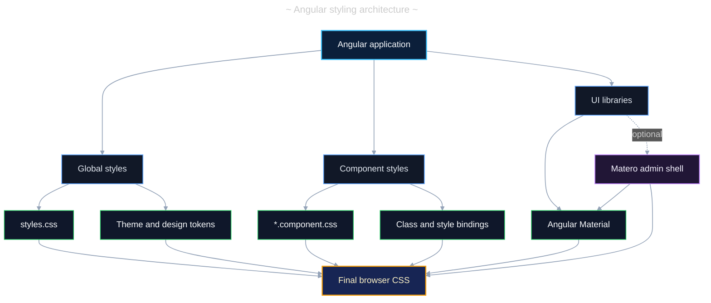

# Angular 21 Styling Options

## Table of Contents

- [(1) Current Project Setup](#1-current-project-setup)
  - [(1.1) Styling Architecture](#11-styling-architecture)
- [(2) Styling Options](#2-styling-options)
  - [(2.1) Component Stylesheets](#21-component-stylesheets)
  - [(2.2) Inline Component Styles](#22-inline-component-styles)
  - [(2.3) Global Styles](#23-global-styles)
  - [(2.4) Class and Style Bindings](#24-class-and-style-bindings)
  - [(2.5) Host Element Styling](#25-host-element-styling)
  - [(2.6) CSS Custom Properties](#26-css-custom-properties)
  - [(2.7) View Encapsulation](#27-view-encapsulation)
- [(3) Stylesheet Languages](#3-stylesheet-languages)
- [(4) UI Libraries and Frameworks](#4-ui-libraries-and-frameworks)
  - [(4.1) Popularity Metrics](#41-popularity-metrics)
  - [(4.2) Matero](#42-matero)
- [(5) Recommended Project Strategy](#5-recommended-project-strategy)
- [(6) Theme Implementation](#6-theme-implementation)
- [(7) Guidelines](#7-guidelines)
- [(8) References](#8-references)

---

## (1) Current Project Setup

The project uses plain CSS with Angular Material and supports light, dark, and
system theme preferences.

| # | Area | Current Choice | Location |
| -: | ---- | -------------- | -------- |
| 1 | Component styling | External CSS files | `src/app/**/*.component.css` |
| 2 | Global styling | One global CSS entry point | `src/styles.css` |
| 3 | UI library | Angular Material 21 | `package.json` |
| 4 | Material theme | `azure-blue.css` prebuilt theme | `src/styles.css` |
| 5 | Theme selection | `light`, `dark`, or `system` | `data-theme` on `<html>` |
| 6 | Theme persistence | Browser local storage | `nav-bar.component.ts` |
| 7 | Style budgets | 2 kB warning and 4 kB error per component | `angular.json` |

The global stylesheet is registered for both application builds and tests in
`angular.json`.

### (1.1) Styling Architecture

The browser receives CSS assembled from the global theme, component-level
styles, and UI-library styles. Matero is an optional application shell built
on Angular Material rather than a replacement for Angular's styling system.



---

## (2) Styling Options

### (2.1) Component Stylesheets

An external stylesheet keeps a component's template, behavior, and styles in
separate files. This is the project's default and the preferred option for
most components.

```ts
// src/app/shared/components/example/example.component.ts
import { Component } from '@angular/core';

@Component({
  selector: 'app-example',
  templateUrl: './example.component.html',
  styleUrl: './example.component.css'
})
export class ExampleComponent {}
```

Use `styleUrls` when a component intentionally needs multiple stylesheets.

```ts
// src/app/shared/components/example/example.component.ts
@Component({
  selector: 'app-example',
  templateUrl: './example.component.html',
  styleUrls: [
    './example.component.css',
    './example.component.print.css'
  ]
})
export class ExampleComponent {}
```

### (2.2) Inline Component Styles

The `styles` property places CSS inside the component metadata. It is useful
for very small components, demonstrations, and styles that are unlikely to
grow.

```ts
// example.component.ts
@Component({
  selector: 'app-example',
  template: '<p class="message">Ready</p>',
  styles: `
    .message {
      color: var(--mat-sys-primary);
      font-weight: 600;
    }
  `
})
export class ExampleComponent {}
```

Prefer an external file once inline styles become difficult to scan or reuse.

### (2.3) Global Styles

Global styles apply across the application. Use `src/styles.css` for rules
that truly have application-wide scope, such as:

- Angular Material theme imports.
- CSS resets and box sizing.
- Root-level design tokens.
- Page background, typography, and default link styles.
- Theme selectors that must also affect overlay-based components.
- Small, intentionally shared utility classes.

Additional global stylesheets can be registered in `angular.json`.

```jsonc
// angular.json
{
  "styles": [
    "src/styles.css",
    "src/assets/styles/print.css"
  ]
}
```

Avoid placing feature-specific selectors in the global stylesheet because they
can affect unrelated components and make the cascade harder to reason about.

### (2.4) Class and Style Bindings

Use bindings when presentation depends on component state. Prefer class
bindings for reusable visual states and style bindings for genuinely dynamic
values.

```html
<!-- example.component.html -->
<article
  [class.is-selected]="isSelected()"
  [class.has-error]="hasError()"
  [style.--progress]="progress() + '%'"
>
  Account status
</article>
```

```css
/* example.component.css */
article {
  border-inline-start: 0.25rem solid transparent;
}

article.is-selected {
  border-inline-start-color: var(--mat-sys-primary);
}

article.has-error {
  color: var(--mat-sys-error);
}
```

Do not build large style strings in templates. Move repeated states into CSS
classes or custom properties.

### (2.5) Host Element Styling

Use `:host` to style the component element itself and the `host` metadata
property to bind host classes, attributes, or styles.

```ts
// status-badge.component.ts
@Component({
  selector: 'app-status-badge',
  template: '<ng-content />',
  styleUrl: './status-badge.component.css',
  host: {
    '[class.is-active]': 'active()',
    '[attr.aria-live]': "'polite'"
  }
})
export class StatusBadgeComponent {
  readonly active = input(false);
}
```

```css
/* status-badge.component.css */
:host {
  display: inline-flex;
  align-items: center;
}

:host(.is-active) {
  color: var(--mat-sys-primary);
}
```

### (2.6) CSS Custom Properties

CSS custom properties are the preferred way to share theme-aware values
between global and component styles. They inherit through the DOM and work
well with Angular Material's system tokens.

```css
/* src/styles.css */
:root {
  --app-content-max-width: 75rem;
  --app-page-spacing: clamp(1rem, 3vw, 2rem);
  --app-transition-duration: 180ms;
}
```

```css
/* feature.component.css */
.page {
  width: min(100% - (2 * var(--app-page-spacing)), var(--app-content-max-width));
  margin-inline: auto;
}
```

Prefix application-owned properties with `--app-` to distinguish them from
Angular Material tokens such as `--mat-sys-primary`.

### (2.7) View Encapsulation

Angular controls how component styles are scoped through `ViewEncapsulation`.

| # | Mode | Scope | Recommended Use |
| -: | ---- | ----- | --------------- |
| 1 | `Emulated` | Component selectors are rewritten and scoped | Default for application components |
| 2 | `ShadowDom` | Native browser shadow root isolates the component | Deliberately isolated web components |
| 3 | `ExperimentalIsolatedShadowDom` | Shadow DOM with stricter style isolation | Experiments after checking current support |
| 4 | `None` | Component styles become global | Rare shared or third-party integration cases |

`Emulated` is the default and should remain the normal choice. Global styles
can still affect emulated components. Avoid new uses of `::ng-deep`; Angular
retains it for compatibility but strongly discourages it.

```ts
// isolated-widget.component.ts
import { Component, ViewEncapsulation } from '@angular/core';

@Component({
  selector: 'app-isolated-widget',
  templateUrl: './isolated-widget.component.html',
  styleUrl: './isolated-widget.component.css',
  encapsulation: ViewEncapsulation.ShadowDom
})
export class IsolatedWidgetComponent {}
```

---

## (3) Stylesheet Languages

Angular supports tools that compile to CSS. Angular CLI directly supports CSS,
SCSS, Sass, and Less for component styles.

| # | Option | Strengths | Trade-Offs | Fit for This Project |
| -: | ------ | --------- | ---------- | -------------------- |
| 1 | CSS | Native, simple, no preprocessing | Fewer compile-time helpers | ✅ Current and recommended |
| 2 | SCSS | Mixins, modules, functions, nesting | Adds syntax and migration work | 🤔 Useful for custom Material themes |
| 3 | Sass | Same feature family as SCSS | Indented syntax is less common | ❌ No clear project benefit |
| 4 | Less | Variables, mixins, nesting | Smaller Angular ecosystem presence | ❌ No clear project benefit |

Modern CSS already provides custom properties, nesting, cascade layers,
container queries, and logical properties. Stay with CSS unless a concrete
need, such as Angular Material's Sass theming API, justifies SCSS.

---

## (4) UI Libraries and Frameworks

| # | Option | Model | Advantages | Considerations | Project Fit |
| -: | ------ | ----- | ---------- | -------------- | ----------- |
| 1 | Angular Material | Angular component library | Native Angular APIs, accessibility, Material tokens | Material visual language and bundle cost | ✅ Already adopted |
| 2 | Custom CSS | Project-owned styles | Full control and no extra dependency | Requires a maintained design system | ✅ Use with Material |
| 3 | Tailwind CSS | Utility-first framework | Fast composition and constrained values | Verbose templates and new tooling | 🤔 Consider only with team agreement |
| 4 | Bootstrap | CSS and JavaScript framework | Familiar grid and utilities | Can overlap with Material components | ❌ Avoid mixing component systems |
| 5 | PrimeNG | Angular component library | Broad data and enterprise widgets | Duplicate role with Angular Material | ❌ Choose one primary library |
| 6 | Matero | Angular Material admin template | Complete admin shell, themes, layouts, and utilities | Broad architectural impact | 🤔 Evaluate for admin-first products |

Combining a component library with small amounts of project-owned CSS is
reasonable. Combining multiple full component libraries usually creates
duplicate dependencies, inconsistent interaction patterns, and competing
theme systems.

### (4.1) Popularity Metrics

The following metrics provide a rough indication of ecosystem adoption. npm
downloads cover October 12-18, 2026. GitHub stars were captured on October 20,
2026.

| # | Option | npm Downloads per Week | GitHub Stars | Popularity Signal |
| -: | ------ | ---------------------: | -----------: | ----------------- |
| 1 | Angular Material | 1,322,982 | 25,034 | ✅ High Angular-specific adoption |
| 2 | Custom CSS | Not applicable | Not applicable | ✅ Universal browser baseline |
| 3 | Tailwind CSS | 84,655,401 | 97,945 | ✅ Very high cross-framework adoption |
| 4 | Bootstrap | 3,139,650 | 175,005 | ✅ Large and mature ecosystem |
| 5 | PrimeNG | 390,955 | 12,483 | ✅ Established Angular ecosystem |
| 6 | Matero | 946 | 1,475 | 🤔 Niche admin-template community |

Angular Material's star count represents the shared `angular/components`
repository, which also contains the Angular CDK. Custom CSS has no canonical
npm package or GitHub repository. Downloads and stars are directional signals,
not quality scores; automated builds, transitive dependencies, project age,
and the breadth of each repository affect the numbers.

### (4.2) Matero

Ng-Matero, commonly called Matero, is an open-source Angular admin template
built with Angular Material. It provides more than visual styles: it supplies
an opinionated application shell and common administration features.

| # | Capability | What Matero Adds |
| -: | ---------- | ---------------- |
| 1 | Layouts | Multiple responsive admin-layout options |
| 2 | Theming | A color system, dark mode, and CSS helpers |
| 3 | Navigation | Dashboard-oriented menus and routing structure |
| 4 | Application concerns | Authentication, HTTP interceptors, and permissions |
| 5 | Localization | Internationalization and right-to-left layout support |
| 6 | Developer tooling | Schematics for generating modules and pages |
| 7 | Components | Integration with the separate Material Extensions library |

Matero and Material Extensions solve different problems:

| # | Package | Purpose | Adoption Scope |
| -: | ------- | ------- | -------------- |
| 1 | `ng-matero` | Full Angular Material admin application template | Application-wide |
| 2 | `@ng-matero/extensions` | Additional Material-compatible UI components | Feature-by-feature |

The Matero compatibility table maps Angular 21 and Angular Material 21 to the
Matero 21.x and Material Extensions 21.x release lines. Keep all four major
versions aligned when evaluating it for this repository.

For a new or disposable evaluation application, Matero supports an Angular
schematic:

```powershell
# Run Matero's setup schematic against this named Angular project.
pnpm exec ng add ng-matero --project=ng-template-one
```

Treat this command as a scaffold integration, not as a styling-only package
installation. It can introduce layouts, routes, configuration, dependencies,
and conventions that overlap with the existing `core`, `features`, and
`shared` structure.

| # | Situation | Recommendation | Status |
| -: | --------- | -------------- | :----: |
| 1 | Starting a dashboard-centric application | Use Matero as the initial application foundation | ✅ |
| 2 | Adding a few advanced Material controls | Evaluate `@ng-matero/extensions` independently | ✅ |
| 3 | Replacing this template's current admin shell | Prototype in a separate branch and compare architecture first | 🤔 |
| 4 | Looking only for colors or utility classes | Keep the existing Material theme and project CSS | ❌ |

For this project, adopting all of Matero would be an architectural migration.
The lower-risk option is to keep the existing Angular Material foundation and
select individual ideas or extension components only when they satisfy a
specific requirement.

---

## (5) Recommended Project Strategy

| # | Concern | Recommendation |
| -: | ------- | -------------- |
| 1 | Component layout and appearance | Keep styles in each component's `.component.css` file |
| 2 | Shared colors and typography | Consume Angular Material system tokens |
| 3 | Project-specific tokens | Define prefixed custom properties in `src/styles.css` |
| 4 | Dynamic visual states | Bind classes; bind styles only for variable values |
| 5 | Theme switching | Continue using `data-theme` on the root element |
| 6 | Encapsulation | Keep the default `Emulated` mode |
| 7 | Reusable UI | Create shared Angular components instead of copying selectors |
| 8 | Framework changes | Add another framework only for a documented unmet requirement |

This approach preserves the current low-complexity CSS setup while leaving a
clear migration path to a custom SCSS-based Angular Material theme if stronger
brand control becomes necessary.

---

## (6) Theme Implementation

The application applies a theme preference before Angular starts, which helps
prevent a visible flash of the wrong color scheme. The navigation component
then updates the same `data-theme` value and persists the choice.

```html
<!-- src/index.html -->
<script>
  document.documentElement.dataset['theme'] =
    localStorage.getItem('theme') ?? 'system';
</script>
```

The global CSS maps the explicit and system preferences to the browser color
scheme and Angular Material system tokens.

```css
/* src/styles.css */
:root {
  color-scheme: light;
}

:root[data-theme='dark'] {
  color-scheme: dark;
}

@media (prefers-color-scheme: dark) {
  :root[data-theme='system'] {
    color-scheme: dark;
  }
}
```

Keep theme-level custom properties on `:root` so Angular Material overlays,
such as menus and dialogs, inherit the same values as the main application.

---

## (7) Guidelines

- Prefer semantic class names such as `.article-card` and `.is-selected`.
- Use logical properties such as `margin-inline` and `padding-block` when
  possible.
- Use `rem`, percentages, `clamp()`, and responsive layout primitives instead
  of fixed pixel layouts.
- Keep selector specificity low and avoid `!important` unless overriding an
  external rule cannot be avoided.
- Style Angular Material through supported theme tokens and APIs instead of
  targeting internal DOM selectors.
- Verify keyboard focus, contrast, reduced motion, zoom, and narrow viewport
  behavior for every interactive component.
- Monitor the `anyComponentStyle` budget when adding component CSS.
- Use CSS cascade layers if the project later needs explicit ordering between
  reset, library, component, utility, and override rules.

---

## (8) References

- Angular component styling: <https://angular.dev/guide/components/styling>
- Angular build command and style language options:
  <https://angular.dev/cli/build>
- Angular Material theming:
  <https://material.angular.dev/guide/theming>
- Ng-Matero repository, features, installation, and compatibility:
  <https://github.com/ng-matero/ng-matero>
- Ng-Matero Material Extensions:
  <https://github.com/ng-matero/extensions>
- npm downloads API:
  <https://github.com/npm/registry/blob/main/docs/download-counts.md>
- Angular Material and CDK repository:
  <https://github.com/angular/components>
- Tailwind CSS repository: <https://github.com/tailwindlabs/tailwindcss>
- Bootstrap repository: <https://github.com/twbs/bootstrap>
- PrimeNG repository: <https://github.com/primefaces/primeng>
